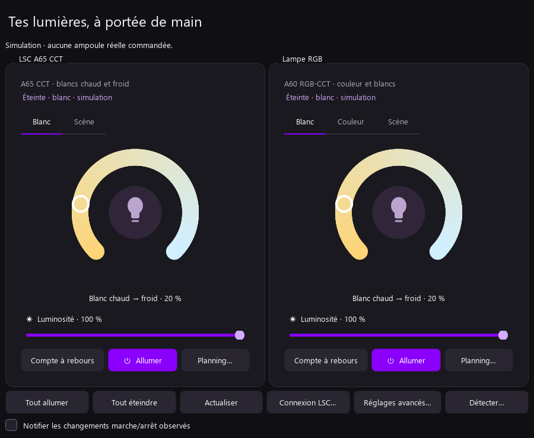
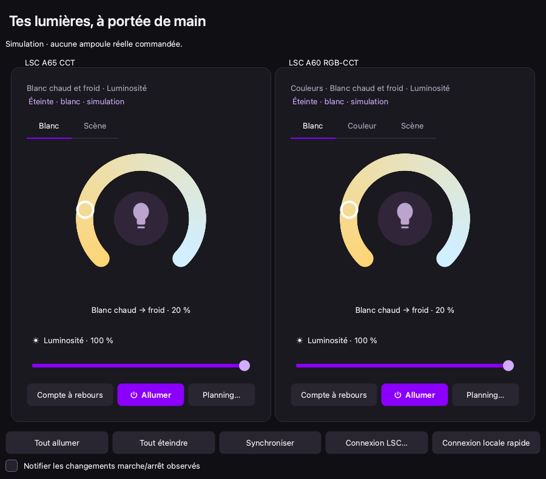
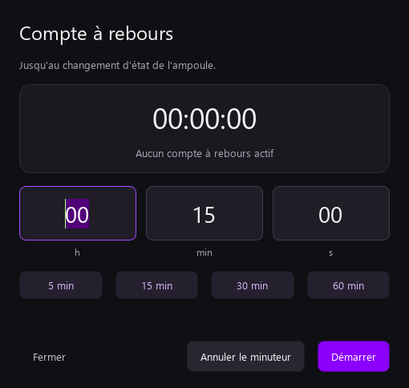
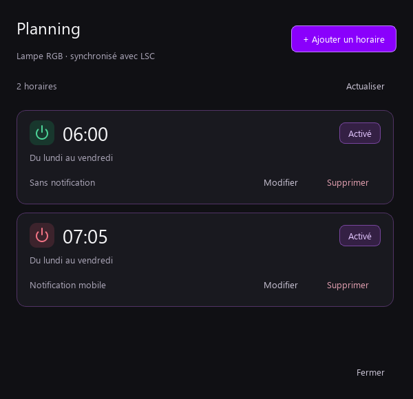

# LSC Control

**Vos lumières LSC, sur Windows et dans la barre des menus de votre Mac.**

[](https://github.com/BLK185/lsc-control/actions/workflows/windows.yml)
[](https://github.com/BLK185/lsc-control/actions/workflows/macos.yml)
[](https://github.com/BLK185/lsc-control/releases)
[](LICENSE)

Une application de bureau pour les **éclairages enregistrés dans votre compte LSC Smart Connect** : ampoules, rubans et luminaires reconnus. Les A65 CCT et A60 RGB-CCT ont servi aux premiers essais. L’objectif est de retrouver les réglages du téléphone, les commandes rapides et le planning partagé, sans imposer de migration vers une autre application.

Projet personnel développé avec **OpenAI Codex**, avec l’aide de **REA (Reverse Engineer Anything)** pour l’analyse d’interopérabilité. Il n’est ni édité ni certifié par LSC, Action ou Tuya.



## Version Windows

Télécharger l’[installateur ou l’archive portable dans les releases](https://github.com/BLK185/lsc-control/releases). L’installateur s’utilise sans droits administrateur. Le programme n’est pas signé numériquement ; les empreintes SHA-256 sont jointes à chaque version.

**La connexion LSC est maintenant préparée au premier lancement.** Ouvrir **Connexion LSC → Préparer la connexion LSC** : l’application télécharge environ 64 Mo depuis les sources officielles Action et 7-Zip, vérifie des empreintes fixes et extrait les composants dans le profil Windows. Les installateurs téléchargés ne sont pas lancés. Scanner ensuite le QR dans LSC Smart Connect et confirmer sur le téléphone. Aucun fichier privé à demander au développeur, aucun mot de passe à saisir dans LSC Control.

Cette interopérabilité utilise localement le composant officiel Battletron 2.0.17 ; elle n’est pas un support officiel de LSC Control par le fabricant. Le téléphone peut afficher **LSC Battletron** lors de l’autorisation. Si Action retire cette version ou modifie le service, une adaptation pourra être nécessaire. Un fichier officiel déjà téléchargé peut aussi être sélectionné, avec les mêmes contrôles d’intégrité.

→ [Installation et configuration Windows](docs/INSTALLATION_WINDOWS.md)

## Version macOS Apple Silicon — 0.4.0

Le [DMG pour Mac M1 à M4 et suivants](https://github.com/BLK185/lsc-control/releases/tag/v0.4.0) contient une application autonome : glisser **LSC Control** dans **Applications**, puis préparer la connexion et scanner le QR avec LSC Smart Connect. Aucun transfert de session Windows, installation de Python ou usage de Rosetta n’est nécessaire. macOS 13 ou ultérieur est requis.

La fenêtre reprend couleurs, blancs, scènes disponibles, compte à rebours et planning partagé. L’icône de barre des menus propose les commandes individuelles et groupées. Fermer la fenêtre laisse ces commandes disponibles ; `⌘Q` quitte l’app. Les appareils ajoutés sur le téléphone sont synchronisés depuis le compte.

La préparation Mac extrait les ressources du client officiel et les lit en Python ; elle **n’exécute ni Electron Windows ni la DLL fabricant**. Un QR anonyme a été obtenu avec cette préparation sans restaurer de session. L’autorisation sur le téléphone et les commandes physiques restent à vérifier sur le Mac du propriétaire.

**Préversion sans notarisation Apple** : la première ouverture peut demander **Réglages Système → Confidentialité et sécurité → Ouvrir quand même**. La version 0.4.0 fournit l’icône de barre des menus ; elle a été validée sur Mac M4 par le propriétaire, y compris les commandes et le planning partagé.

### Centre de contrôle — préversion 0.5.0 expérimentale

Une [préversion séparée](https://github.com/BLK185/lsc-control/releases/tag/v0.5.0-beta.1) ajoute une extension WidgetKit pour macOS 26 et suivants. La commande **Éclairage LSC** permet de choisir n’importe quel éclairage du compte ou tous ensemble, puis d’en régler le marche/arrêt. Les autres réglages restent dans l’app.

La première association utilise **LSC Control → Centre de contrôle… → Copier le code de connexion**, puis ce code dans la configuration de la commande native. Ce code local donne uniquement accès aux lumières et à leur marche/arrêt. Aucun groupe d’applications Apple ni partage de la session LSC n’est nécessaire. L’app doit rester active dans la barre des menus.

Cette extension utilise une signature locale sans notarisation. Sa compilation, son client Swift et son enregistrement sont vérifiés en CI ; sa présence et son exécution dans le vrai Centre de contrôle restent à confirmer sur le Mac du propriétaire. Cette préversion ne remplace pas cette validation par un simple succès de compilation.

→ [Installation et configuration macOS](docs/INSTALLATION_MACOS.md)



## Ce que l’application permet

| Fonction | État |
| --- | --- |
| Marche/arrêt, luminosité, blancs chaud/froid | Implémenté |
| Couleur et saturation, selon le schéma de l’éclairage | Implémenté ; essais physiques sur l’A60 RGB-CCT |
| Liste des éclairages du compte, ajouts/retraits/renommages | Synchronisation automatique environ toutes les 30 s, application ouverte ; bouton Synchroniser pour forcer |
| Filtrage Lighting, exclusion HDMI et appareils non lumineux | Implémenté selon catégorie et fonctions ; autres modèles à valider physiquement |
| Appairage d’un nouvel éclairage | Depuis LSC mobile, puis synchronisation Windows ; appairage Windows natif non livré |
| Icône de notification, commandes individuelles et groupées | Implémenté |
| Compte à rebours interne à l’ampoule, jusqu’à 24 h | Implémenté et confirmé par le propriétaire sur la RGB |
| Lecture, ajout, modification, activation et suppression du planning LSC | Implémenté et confirmé par le propriétaire |
| Connexion QR au compte LSC existant | Préparation locale guidée depuis les sources officielles ; QR serveur vérifié avec un profil sans session ni module privé |
| Contrôle LAN rapide et repli cloud | Implémenté ; cloud selon configuration et disponibilité du service |
| Scènes et conservation des dernières variantes reçues | Implémenté ; validation physique complète encore à faire |
| Notifications Windows des changements marche/arrêt observés | Disponible ; ce ne sont pas les événements push LSC |
| macOS Apple Silicon | App et barre des menus 0.4.0 validées sur Mac M4 ; Centre de contrôle 0.5.0 expérimental à valider sur ce Mac |

Les changements du téléphone sont repris lors des lectures d’état. Le planning reste celui du compte LSC : aucun ordonnanceur parallèle n’est créé sur le PC. Le compte à rebours et les horaires continuent sans laisser l’ordinateur allumé.

Les scènes non reçues du compte utilisent des ambiances proposées ; l’application ne prétend pas importer tout le catalogue personnalisé du téléphone. Les commandes visibles dépendent des fonctions modifiables déclarées par chaque appareil. Les catégories d’éclairage standard sont reconnues ; un schéma absent ou inconnu peut empêcher la prise en charge. La compatibilité physique de tous les modèles du catalogue n’est pas établie.

## Une interface simple

Anthracite, violet profond et accent violet vif. Le minuteur sépare les unités des champs ; un clic sélectionne les chiffres à remplacer. Dans un horaire, heures et minutes s’éditent séparément.

Les curseurs de luminosité et de saturation se règlent par clic ou glissement sur toute la barre. Leur zone de saisie est plus haute que le trait visible ; le curseur suit la souris et les anciennes lectures n’écrasent pas un réglage en attente. Une seule commande est envoyée au relâchement.

Le planning utilise une icône **verte pour allumer**, **rouge pour éteindre**. L’activation de l’horaire est affichée à part.

| Compte à rebours | Planning |
| --- | --- |
|  |  |

## Démarche et historique

- [Pourquoi et comment : Codex, REA, QR, LAN et planning partagé](docs/DEMARCHE.md)
- [Journal des étapes des 13, 14 et 18 octobre 2026](CHANGELOG.md)
- [Confidentialité et signalements](SECURITY.md)

Le journal reconstitue le travail à partir des notes et essais. Les commits de publication sont créés à leur date réelle ; ils ne simulent pas une activité GitHub passée.

## Développer et tester

Python 3.12, Windows x64 et macOS Apple Silicon sont les environnements de construction.

```powershell
python -m venv .venv
.\.venv\Scripts\python.exe -m pip install -r app/requirements-windows.lock.txt
.\.venv\Scripts\python.exe app/desktop.py --demo
.\.venv\Scripts\python.exe -m unittest discover -s app -p "test_*.py"
```

**160 tests automatiques** couvrent transports, conversions, planning, stockage des sessions, import privé, interaction des panneaux, saisie au clic, catalogue dynamique, ciblage de la file groupée, intégrité des téléchargements, annulation et préparation de connexion. Ils n’utilisent aucun compte réel. Les validations physiques du propriétaire sont indiquées séparément.

Pour compiler l’installateur public, installer [Inno Setup 6](https://jrsoftware.org/isdl.php), puis :

```powershell
.\.venv\Scripts\python.exe tools/build_windows.py
```

Les fichiers sont produits dans `release/`. Le script ne copie aucune identité privée ; la CI Windows suit la même recette et publie ses artefacts. Les releases publiques sont préparées après revue des fichiers et contrôle de confidentialité.

## Données et licences

Les sessions et clés des ampoules restent dans le coffre du système ; les paramètres et composants préparés restent dans le profil local. Aucun profil du développeur n’est embarqué. Les captures du dépôt sont générées avec des données fictives. Les rapports bruts, APK, exécutables fabricant et identités privées sont exclus du dépôt et des paquets publiés. Le composant officiel téléchargé à la demande reste propre à chaque poste.

Code original sous [licence MIT](LICENSE). Les dépendances conservent leurs licences : [notices tierces](THIRD_PARTY_NOTICES.md).
